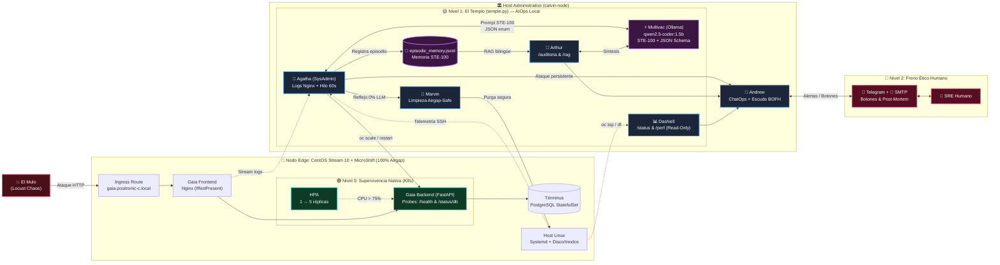

# 👁️ Precogs v2.0: Observabilidad Predictiva, SysAdmin Autónoma y RAG Offline

En *Minority Report* de Philip K. Dick, los "Precogs" ven los crímenes antes de que sucedan. En **PositronicOps v2.0**, el directorio `/precogs` es el sistema nervioso central de operaciones: combina reflejos deterministas de SysAdmin, inferencia local acotada (**ASD-STE100 + JSON Schema**) y memoria episódica sobre **CentOS Stream 10 + MicroShift** en modo *Airgap*.

## 🌌 Topología de la Solución (v2.0)



## 🛡️ Defensa en 3 Niveles

1. **Nivel 0 — Supervivencia Nativa (Kubernetes):** `livenessProbe` (`/health`), `readinessProbe` (`/status/db`) y `HPA` (1 → 5 réplicas) absorben carga y fallas triviales sin quemar tokens.
2. **Nivel 1 — SysAdmin Autónoma (Agatha + Multivac):**
   - **Reflejos deterministas (0% LLM):** Saturación de disco/inodos (≥ 90%) invoca a Marvin; caída de `microshift`/`crio` dispara `systemctl`.
   - **Respaldo cognitivo local:** Ante patrones ambiguos, consulta a `qwen2.5-coder:1.5b` (Ollama) con instrucciones **ASD-STE100**, `temperature: 0.0` y **JSON Schema (`format`)** con lista blanca de acciones (`enum`). *El LLM propone; Python valida y dispone.*
3. **Nivel 2 — Freno Ético Humano (Andrew / Telegram + SMTP):** Si una anomalía sobrevive al periodo de gracia, la IA se detiene, despliega botones de contención interactivos y envía el reporte post-mortem por correo electrónico.

## 🏛️ Temple: El Orquestador Central (`temple.py`)

Centraliza el ecosistema mediante hilos sincronizados (`threading.Lock`) y actúa como API Gateway hacia Telegram con escudo BOFH integrado.

**Comandos Operativos Soportados:**
* `/status` - Estado en vivo de contenedores (Dashiell).
* `/perf` - Telemetría de CPU, RAM y Disco físico (Dashiell).
* `/agatha` - Pulso SysAdmin y nivel de amenaza actual (Agatha).
* `/auditoria` - Auditoría incremental sobre memoria episódica y logs (Arthur).
* `/rag <pregunta>` - Consulta RAG interactiva citando *timestamps* exactos (Arthur).
* `/marvin` - Ejecución bajo demanda de limpieza segura *Airgap* (Marvin).
* `/nivel1` - Bitácora estructurada desde `episodic_memory.jsonl`.
* `/resumen` - Dashboard ejecutivo global de defensas.
* `/baneados` - Muro de la Vergüenza (comandos BOFH interceptados).
* `/ping` y `/?` - Enlace y manual de operaciones.

## 🧠 Arthur v2.0: Memoria Episódica y RAG 100% Offline (`arthur.py`)

Cada incidente resuelto o escalado se persiste en `episodic_memory.jsonl` con su resumen en **ASD-STE100**. Arthur realiza recuperación determinista en Python con expansión bilingüe de sinónimos SRE (`disco <-> disk`, `memoria <-> oom`) y sintetiza respuestas con Multivac sin requerir bases vectoriales pesadas en el Edge.

## 🚀 Puesta en Marcha

```bash
cd precogs
cp .env.example .env
vim .env

source ../chaos/venv/bin/activate
python3 temple.py
```

---
👤 **Alex Callejas (`@dark_axl` / `@rootzilopochtli`)** *Technical Training Developer en Red Hat | Líder de Fedora México*
